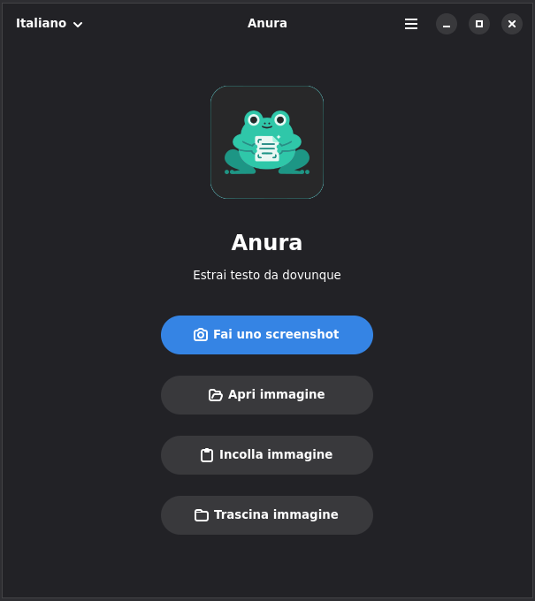
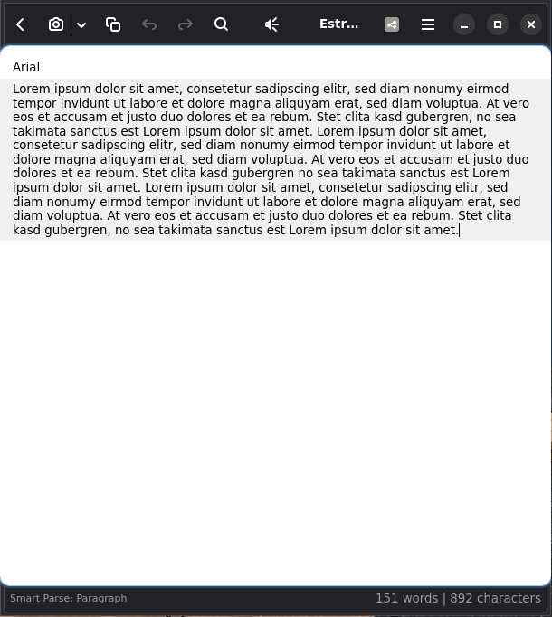
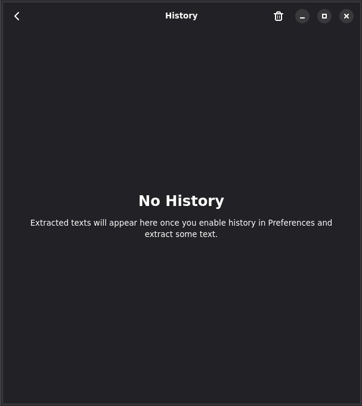
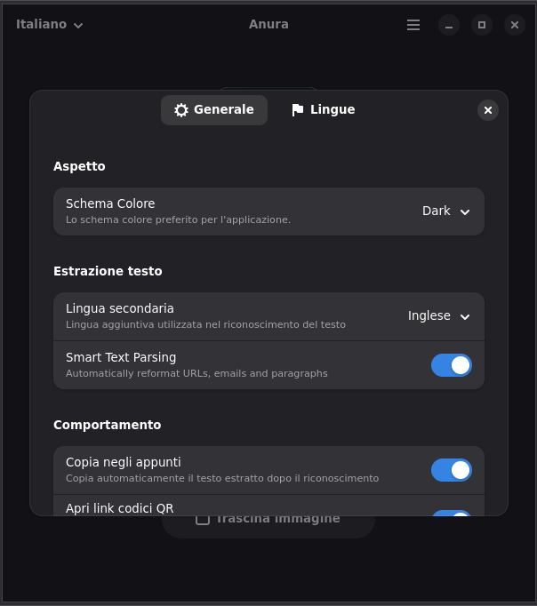

<h1 align="center">Anura</h1>

<p align="center">
  Jumping from pixels to text in a single leap
</p>

<p align="center">
  <strong>Intuitive text extraction for the Linux desktop.</strong><br>
  OCR · QR/Barcode Decoding · Privacy-first · Native GTK4
</p>

<table align="center">
  <tr>
    <td align="center">
      <br>
      <sub>Capture, open, paste or drag an image</sub>
    </td>
    <td align="center">
      <br>
      <sub>OCR results in the built-in editor with smart parsing</sub>
    </td>
  </tr>
  <tr>
    <td align="center">
      <br>
      <sub>Opt-in local extraction history</sub>
    </td>
    <td align="center">
      <br>
      <sub>Appearance, OCR and behaviour preferences</sub>
    </td>
  </tr>
</table>

<p align="center">
  <a href="https://github.com/D3M-Sudo/Anura/releases/latest">
    
  </a>
  <a href="LICENSE">
    
  </a>
  <a href="https://hosted.weblate.org/engage/anura/">
    
  </a>
  <a href="https://github.com/D3M-Sudo/Anura/releases/latest">
    
  </a>
</p>

---

Anura lets you capture any region of your screen and instantly extract the text inside — from videos, screencasts, PDFs, webpages, or photos. The result lands straight in your clipboard, ready to paste.

It also decodes **QR codes and Barcodes** in a single click using **zxing-cpp**, with full system integration on modern GTK-based Linux desktops.

---

## Features

| | |
| --- | --- |
| 📷 **Instant OCR** | Select a screen region — text is copied automatically |
| 🔲 **QR & Barcode Decoding** | Robust recognition via `zxing-cpp` (QR, DataMatrix, UPC, etc.) |
| 🌍 **Multi-language** | Supports 100+ Tesseract models with pooling for simultaneous multi-lang OCR |
| 🔊 **Text-to-Speech** | Read extracted text aloud via gTTS + GStreamer `playbin3` |
| 🎨 **Theme Selector** | Choose between System, Light, or Dark theme via Adw.StyleManager |
| ⚙️ **Organized Preferences** | Dedicated General, Editor, Voice and Languages pages for application behaviour, editor options, TTS controls and OCR language management |
| ✏️ **Selection-Aware Actions** | Text statistics and actions based on selection in OCR results |
| ↩️ **Undo/Redo** | Full undo/redo support in ExtractedPage for text editing workflow |
| ✏️ **GtkSourceView Editor** | Native search bar, editor preferences, and "Open in External Editor" handoff in OCR results |
| 🔒 **Privacy-first** | OCR runs locally — no telemetry or tracking. Optional TTS sends selected text to Google; sharing opens a prefilled external compose surface and does not publish automatically ([details](SECURITY.md#data-flows)) |
| 🎨 **Native GTK4** | Designed for GNOME, built with Libadwaita, GtkSourceView and Blueprint |
| 🚀 **Async D&D** | Smooth, non-blocking asynchronous drag-and-drop |
| ♿ **Enhanced Accessibility** | Improved keyboard navigation, tooltips, and screen reader support |
| ✨ **Smart OCR Cleanup** | Adaptive image enhancement and structural layout reconstruction |
| 🛡️ **Architectural Security** | Transactional worker isolation and OOM prevention guards |
| 📜 **Offline Rotary Logs** | Secure, zero-telemetry local logging system |
| ⌨️ **Keyboard Shortcuts** | Modern shortcut overlay with categorized searchable cheat sheet |
| 🔗 **Share Anywhere** | Open a prefilled share flow for Email, Mastodon, Reddit, Telegram, X, Bluesky or Threads |
| 🕘 **Extraction History** | Opt-in local history with expandable entries, copy, external-editor and text-to-speech actions — see [History V1](docs/reference/history-v1.md) and [History V2](docs/reference/history-v2.md) |

---

## Architecture

The current application is organized around event-driven coordination, explicit service boundaries and asynchronous resource management:

- **Core Services (`anura/core/`)**: Pure infrastructure logic. Includes `boot` (capability audit), `logger` (rotary logging), `atomic_task_manager` (isolated worker pool), and `resources`.
- **Business Services (`anura/services/`)**: High-level I/O and resource management. Includes `language_manager` (Tessdata coordination), specialized language managers (DownloadManager, CacheManager, LanguageValidator), `screenshot` (multi-provider capture factory), `history_service` (opt-in local JSON history, see [History V1](docs/reference/history-v1.md) and [History V2](docs/reference/history-v2.md)), and `settings`.
- **Event-Driven Controllers (`anura/controllers/`)**: Logic-only components that emit GLib signals. `OcrController` (OCR + history recording gate), `TtsController`, and `DndController` are fully decoupled from UI side-effects, which are handled by the main application coordinator.
- **Semantic Transformers (`anura/transformers/`)**: Implements the **Chain of Responsibility** pattern. The `MagicProcessor` dynamically selects the best `ITransformer` for structured data extraction.
- **Memory Safety**: Uses `weakref.proxy` for View-Controller relationships and asynchronous native Gio APIs for non-blocking I/O.

---

## Installation

### Flatpak

The latest published GitHub Release is [v0.2.1](https://github.com/D3M-Sudo/Anura/releases/tag/v0.2.1). It contains the legacy bundle `io.github.d3msudo.anura.flatpak`; it does **not** yet contain the architecture-specific bundles or `SHA256SUMS` described by the current multi-architecture release pipeline.

The current CI pipeline builds and validates separate bundles for x86_64 and aarch64. Once a release is produced by that pipeline, its assets are expected to be:

| Architecture | Release asset |
| --- | --- |
| x86_64 (Intel/AMD 64-bit) | `io.github.d3m_sudo.anura-x86_64.flatpak` |
| aarch64 (64-bit ARM) | `io.github.d3m_sudo.anura-aarch64.flatpak` |

For the currently published v0.2.1 bundle, install the legacy asset with:

```bash
flatpak install --user ./io.github.d3msudo.anura.flatpak
```

For a future multi-architecture release, download the matching bundle and `SHA256SUMS` from the same release, then verify the downloaded files before installing. The checksum inventory lists both architecture-specific bundles; either download both or verify only the selected bundle's matching checksum entry. See [Flatpak multi-architecture builds and releases](docs/reference/flatpak-multiarch-release.md) for the CI and publication contract.

### AppImage — Release status

Native x86_64 and aarch64 AppImage builds, architecture checks, clean-container smoke tests, embedded GitHub Releases update metadata and matching `.zsync` generation are implemented in CI. However, the latest published release (v0.2.1) predates this pipeline and contains **no AppImage assets**. Do not treat CI artifacts as downloadable release packages.

The next eligible tag-triggered release is expected to publish these assets after both architecture builds and the complete release validation gate succeed:

| Architecture | Release assets |
| --- | --- |
| x86_64 (Intel/AMD 64-bit) | `Anura-<version>-x86_64.AppImage` and matching `.zsync` |
| aarch64 (64-bit ARM) | `Anura-<version>-aarch64.AppImage` and matching `.zsync` |

The release also generates `SHA256SUMS-appimage`. Once those assets appear in a GitHub Release, download the matching AppImage, `.zsync` companion and checksum inventory. For example, verify the x86_64 image with:

```bash
grep 'Anura-.*-x86_64' SHA256SUMS-appimage | sha256sum -c -
chmod +x Anura-<version>-x86_64.AppImage
./Anura-<version>-x86_64.AppImage
```

Replace `<version>` with the published version and `x86_64` with `aarch64` on 64-bit ARM systems. The bundle includes GTK4, Libadwaita, GtkSourceView, PyGObject/GI typelibs, GStreamer, Tesseract and the default English/Italian OCR models. The host still provides the Linux kernel, compatible glibc, graphics/display drivers and an XDG Desktop Portal backend for secure screenshot capture. Additional OCR language models are downloaded on demand; TTS continues to use the external Google TTS service when explicitly invoked.

The embedded GitHub Releases zsync metadata and matching `.zsync` file are intended for differential updates through compatible managers such as Gear Lever. A real update from a previous public AppImage release and desktop integration checks on representative hosts remain pending; see [AppImage multi-architecture builds and updates](docs/reference/appimage-multiarch-release.md) and issue [#555](https://github.com/D3M-Sudo/Anura/issues/555).

### Runtime requirements

Anura captures screenshots through the **XDG Desktop Portal**. The portal frontend is shipped with `xdg-desktop-portal`, but it needs a *backend* matching your desktop session.

| Desktop session | Install command (Ubuntu 24.04+) | Notes |
| --- | --- | --- |
| GNOME / Ubuntu Desktop | already installed | Uses `xdg-desktop-portal-gnome` |
| KDE Plasma / Kubuntu | already installed | Uses `xdg-desktop-portal-kde` |
| **LXQt / Lubuntu** | `sudo apt install xdg-desktop-portal-kde` | The GTK portal (`xdg-desktop-portal-gtk`) does not provide Screenshot on current Ubuntu releases; configure the KDE backend below |
| Xfce / MATE | `sudo apt install xdg-desktop-portal-gnome` | Backend needed for Screenshot interface |
| wlroots (Sway, Hyprland) | `sudo apt install xdg-desktop-portal-wlr` | Requires screencast support |

#### Host screenshot fallback (Flatpak + X11 only)

On **X11 sessions**, if the portal fails, Anura automatically falls back to a **bundled `scrot`** inside the sandbox. This is self-contained and requires no host tools.

---

## Troubleshooting

### Debug Logging

Anura supports configurable logging levels via the `ANURA_LOG_LEVEL` environment variable:

```bash
ANURA_LOG_LEVEL=DEBUG flatpak run io.github.d3m_sudo.anura
```

Valid levels: `TRACE`, `DEBUG`, `INFO` (default), `WARNING`, `ERROR`, `CRITICAL`

---

## Building from Source

### Prerequisites

| Tool | Version |
| ---- | ------- |
| Meson | ≥ 1.5.0 |
| Python | ≥ 3.12 |
| GTK4 + Libadwaita | latest |
| Tesseract OCR | 5.3.4 |
| zxing-cpp | 3.1.1 |
| Leptonica | 1.87.0 |
| Blueprint Compiler | ≥ 0.16.0 |
| gettext | latest |
| uv | latest |

The `5.3.4` entry identifies the **Tesseract OCR engine**, not the language-model data version. Anura pins the downloadable `.traineddata` files separately to the upstream data-repository ref `4.1.0`; these model files are compatible with Tesseract 5.x. See [Tessdata Model Integrity](docs/reference/tessdata-integrity.md#engine-and-traineddata-versions-are-independent) for the distinction and model provenance.

**Ubuntu / Linux Mint / Debian:**

```bash
sudo apt install meson gettext python3-gi gir1.2-gtk-4.0 gir1.2-adw-1 gir1.2-gtksource-5 \
    libgtksourceview-5-dev tesseract-ocr blueprint-compiler libportal-gtk4-dev libxml2-utils \
    leptonica-progs liblibleptonica-dev
```

---

### Meson *(manual)*

```bash
git clone https://github.com/D3M-Sudo/Anura.git
cd Anura

# Setup and build using uv
uv sync --dev
uv run meson setup builddir
uv run meson compile -C builddir

# Run without installing
GSETTINGS_SCHEMA_DIR=builddir/data python3 -m anura.main
```

---

## Code Quality

Anura uses **Ruff** for linting and **pytest** for testing, managed via **uv**.

```bash
# Run headless unit/security tests
uv run pytest tests/ -m "not gtk" -v

# Run GTK integration tests (requires GTK typelibs + compiled schemas/resources).
# PyGObject is NOT installed in the venv (no wheels on PyPI): use system python3-gi
# via PYTHONPATH, as documented in docs/reference/dependencies.md.
./build-aux/setup-gschema.sh
./tests/setup_resources.sh
SP=$(ls -d .venv/lib/python3.*/site-packages)
PYTHONPATH=".:$SP" GI_TYPELIB_PATH="/usr/lib/x86_64-linux-gnu/girepository-1.0:/usr/lib/girepository-1.0" \
  GSETTINGS_SCHEMA_DIR="builddir/data" /usr/bin/python3 -m pytest tests/ -v
```

The test suite includes headless unit tests (logic without GTK dependencies), integration tests (GTK/GLib environment), security/hardening tests (DoS prevention, URI validation, sanitization), and reliability tests (performance benchmarks, concurrency, lifecycle). History V1 behaviour is covered by `tests/test_history_storage.py`, `tests/test_history_controller_integration.py`, `tests/test_history_ui.py`, `tests/test_history_settings.py` (GTK-marked) and `tests/test_preferences_page_resilience.py` (history/TTS wiring regression). Shortcuts overlay consistency is guarded by `tests/test_shortcuts_consistency.py` — see [docs/reference/dependencies.md](docs/reference/dependencies.md) for the headless GTK testing approach.

---

## Documentation

- [ROADMAP.md](ROADMAP.md) — public project direction and priorities
- [docs/README.md](docs/README.md) — documentation index
- [docs/reference/history-v1.md](docs/reference/history-v1.md) — Extraction History V1 (storage and persistence)
- [docs/reference/history-v2.md](docs/reference/history-v2.md) — Extraction History V2 (interactive history rows and actions)
- [SECURITY.md](SECURITY.md) — security policy and outbound data flows
- [docs/reference/dependencies.md](docs/reference/dependencies.md) — Python/Flatpak dependency workflow (uv.lock, sync, FEDC/certifi)
- [docs/reference/tessdata-integrity.md](docs/reference/tessdata-integrity.md) — tessdata model integrity (checksum manifest, fail-closed verification)
- [docs/reference/flatpak-multiarch-release.md](docs/reference/flatpak-multiarch-release.md) — Flatpak x86_64/aarch64 CI and release contract
- [docs/reference/appimage-multiarch-release.md](docs/reference/appimage-multiarch-release.md) — AppImage packaging, zsync metadata and post-release acceptance boundaries
- [docs/reference/code-commenting.md](docs/reference/code-commenting.md) — technical comment and Google-style docstring conventions
- [AGENTS.md](AGENTS.md) — canonical AI-assistant and architecture guide (`CLAUDE.md` is a thin pointer to it)
- [CONTRIBUTING.md](CONTRIBUTING.md) — contributor and development workflow
- [CODE_OF_CONDUCT.md](CODE_OF_CONDUCT.md) — community participation standards
- [SUPPORT.md](SUPPORT.md) — support, bug reports, feature requests and security reporting

---

## Localization

Anura is translated via [Weblate](https://hosted.weblate.org/engage/anura/).

Contributions in any language are welcome.


<p align="center">
 <a href="https://hosted.weblate.org/engage/anura/">
  
 </a>
</p>

**For maintainers** — update translatable strings:

```bash
cd po
./update_potfiles.sh
for f in *.po; do msgmerge -U "$f" io.github.d3m_sudo.anura.pot --backup=none; done
```

---

## License

Released under the **MIT** license. See [`LICENSE`](LICENSE) for details.
